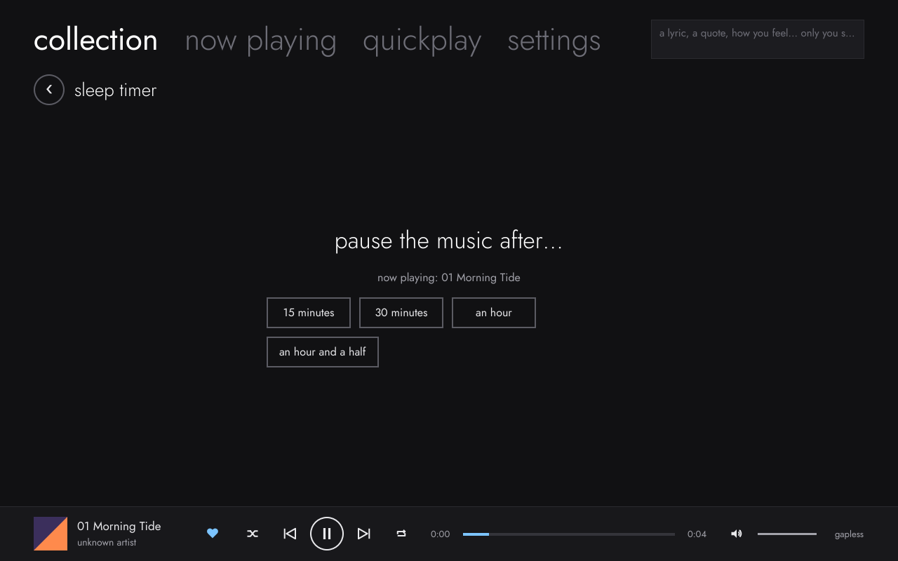
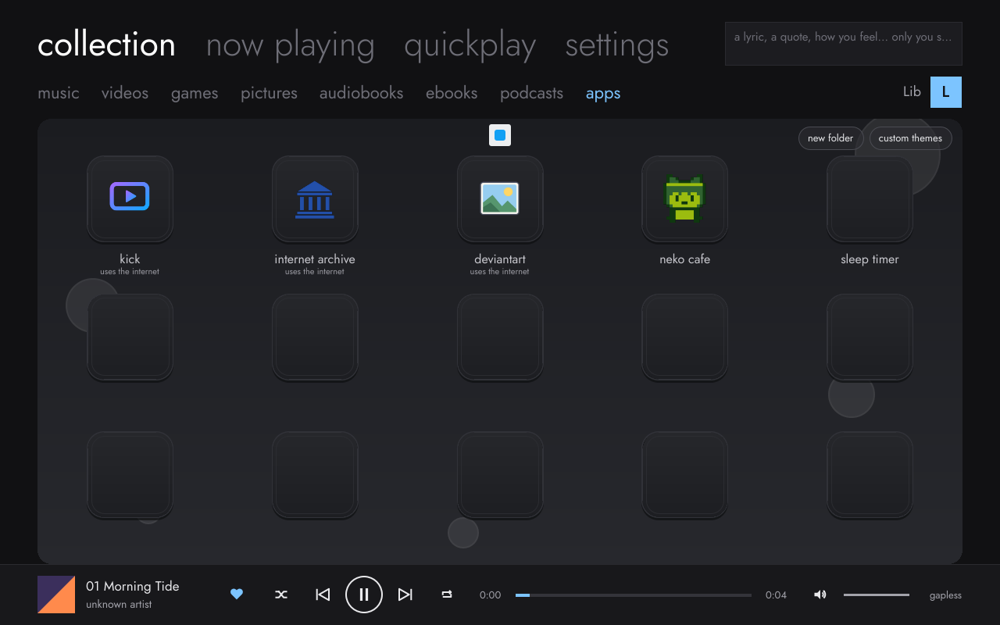

# Example: the sleep timer

The smallest complete app: pick 15, 30, 60 or 90 minutes and the music pauses when the time is up. No network, no stored data.



This folder is an **app repository** (`docs/APP-REPOSITORY.md`): the layout an app has in a repository of its own.

* `app.json`: the manifest (id, name, the tile's pop-up line, no network, the QML file, no icon).
* `qml/SleepTimerApp.qml`: the screen.
* `tests/ui_test.inc`: its UI test (the injector places it immediately before `appsTabHoldsGlassTilesAndAppsOpenInsideTheWindow`; it sets the remaining time to
  2 seconds instead of waiting, and calls `shot("sleep-timer-open")`).
* `sleep-timer.patch`: the same app as one patch against Hop-tunes at commit `bb237909adefb05f99e6058bf05f39ec4e261dcf` (Hop-tunes 1.15.0, `BASE_COMMIT.txt`), for
  the **direct way** (`docs/ADD-AN-APP.md`). It applies cleanly and the whole test suite passes with it (all 19 ctest tests, built on Qt 6.4, the version CI
  uses). The injector produces the same result (checked: the two forks differ only in the marker comments around the test and in where one `Component` line sits).

Put it into **your fork** of Hop-tunes (never the official repository: the script refuses it):

```sh
python3 /path/to/toolkit/scripts/inject_app.py /path/to/toolkit/examples/sleep-timer --fork /path/to/your/Hop-tunes-fork --dry-run    # what it would change
python3 /path/to/toolkit/scripts/inject_app.py /path/to/toolkit/examples/sleep-timer --fork /path/to/your/Hop-tunes-fork
cd /path/to/your/Hop-tunes-fork && cmake -S . -B build -G Ninja -DCMAKE_BUILD_TYPE=RelWithDebInfo && cmake --build build
QT_QPA_PLATFORM=offscreen ctest --test-dir build --output-on-failure
./build/hop-tunes     # settings > apps settings > show the apps tab, then open "sleep timer"
```

What the registration does in the new apps grid (`docs/HOW-APPS-WORK.md`):



* The entry is added **at the end** of `allApps`, so the sleep timer takes the first free spot (the fifth tile) and Kick keeps the first. Added at the
  front it would take Kick's slot and fail Hop-tunes' own grid test.
* It has no icon (`icon: ""`), so it shows the plain glass tile with its name under it. A real app adds a square PNG (`ADD-AN-APP.md`).
* Nothing else is needed for the grid: the person can drag the tile anywhere or put it in a folder, and it is remembered.

The direct way, with the patch:

```sh
git clone https://github.com/<you>/Hop-tunes && cd Hop-tunes      # your fork (the example is only for trying it out; it is not added to official Hop-tunes)
git checkout bb237909adefb05f99e6058bf05f39ec4e261dcf
git apply /path/to/toolkit/examples/sleep-timer/sleep-timer.patch
cmake -S . -B build -G Ninja -DCMAKE_BUILD_TYPE=RelWithDebInfo && cmake --build build
QT_QPA_PLATFORM=offscreen ctest --test-dir build --output-on-failure
./build/hop-tunes     # settings > apps settings > show the apps tab, then open "sleep timer"
python3 /path/to/toolkit/scripts/check_app.py sleeptimer --repo .
```

If your Hop-tunes is newer than the base commit, the patch may need small changes (the three registration files and the test file are the ones every
app touches): your agent can apply it by hand from the patch, and should trust the Hop-tunes source over these docs if they differ.
